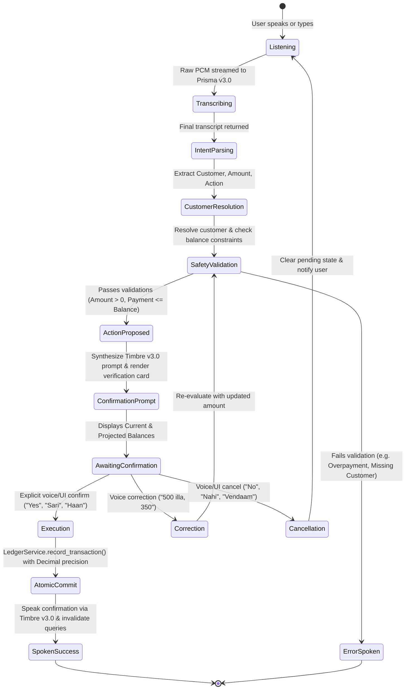

# VoxLedger AI — System Architecture Document
## Phase 3: Gnani Prisma v3.0 + Timbre v3.0 Real-Time Voice Integration

### 1. High-Level Architecture Overview

VoxLedger AI is built as a high-performance, modular full-stack application designed to empower small retail merchants and kirana shopkeepers across India with natural voice-driven bookkeeping in their native Indic languages.

```
┌────────────────────────────────────────────────────────────────────────┐
│                              CLIENT TIER                                │
│   React 18 + TypeScript + Vite + Tailwind CSS                          │
│   • Desktop & Android Mobile Browser Touch-Optimized                   │
│   • Web Audio API AudioStreamer (16kHz 16-bit Mono Linear PCM)         │
│   • Bidirectional Voice WebSocket Hook (Audio chunks + JSON events)    │
│   • Voice Assistant Modal with Live Soundwave Visualizer & Audio TTS   │
│   • Multi-language Selector (Hindi, English, Tamil, Kannada)           │
│   • Two-Step Safety Verification Card (Displays Projected Balances)    │
│   • TanStack Query Server State & Automatic Invalidation               │
└───────────────────────────────────┬────────────────────────────────────┘
                                    │ HTTP / REST & WebSockets
                                    ▼
┌────────────────────────────────────────────────────────────────────────┐
│                              BACKEND TIER                               │
│   FastAPI 0.115+ (Python 3.11+)                                        │
│   • Async Lifespan & Dependency Injection System                       │
│   • Pydantic v2 Settings (GNANI_API_KEY as SecretStr)                  │
│   • Structured Error Interceptors (400, 404, 409, 422)                 │
│   • Ledger Engine Service (Atomic Decimal Financial Math)              │
│   • Voice Workflow Safety Service (Multi-turn session state machine)   │
│   • Multi-dialect Indic Intent Parser (English, Tamil, Hindi, Kannada) │
├───────────────────────────────────┬────────────────────────────────────┤
│  REST API Gateway                 │  Real-Time Voice WebSocket Gateway │
│  /api/v1/customers                │  /api/v1/ws/voice                  │
│  /api/v1/transactions             │  • Upstream PCM audio forwarder    │
│  /api/v1/dashboard                │  • Control events & Fallback text  │
│  /api/v1/voice/status             │  • Natural Voice Confirmation      │
│  /api/v1/voice/tts                │  • Session-scoped safety barrier   │
└─────────────────┬─────────────────┴──────────────────┬─────────────────┘
                  │                                    │ Upstream Secure Stream
                  ▼                                    ▼
┌───────────────────────────────────┐ ┌──────────────────────────────────┐
│         PERSISTENCE TIER          │ │           GNANI AI TIER          │
│  SQLite via aiosqlite Async Driver│ │  • Prisma v3.0 STT WebSocket     │
│  • Alembic Migration Control      │ │    wss://api.vachana.ai/         │
│  • PRAGMA foreign_keys = ON       │ │    stt/v3/stream                 │
│  • Customer Model (UUID v4)       │ │  • Timbre v3.0 TTS Inference API │
│  • Transaction Model (Numeric     │ │    https://api.vachana.ai/       │
│    (12,2) Fixed Decimal, CREDIT/  │ │    api/v1/tts/inference          │
│    PAYMENT, ondelete=RESTRICT,    │ │  • Verified Indic Voices:        │
│    Idempotency Protection)        │ │    Shivani (hi, en, ta, kn)      │
└───────────────────────────────────┘ └──────────────────────────────────┘
```

---

### 2. Voice Pipeline Architecture & Audio Specifications

#### Audio Capture (Client Browser)
- **API**: Standard HTML5 `navigator.mediaDevices.getUserMedia({ audio: true })` + `AudioContext` & `ScriptProcessorNode`.
- **Sample Rate Conversion**: Client downsamples from hardware native rate (e.g. 44.1kHz / 48kHz) to **16,000 Hz**.
- **Format**: 16-bit linear signed little-endian PCM mono (`Int16Array`).
- **Streaming**: Streamed binary frames (~512 to 2048 bytes per frame) over WebSocket.

#### Gnani Prisma v3.0 Real-Time STT Bridge
- **Endpoint**: `wss://api.vachana.ai/stt/v3/stream`
- **Headers**:
  - `x-api-key-id`: Gnani / Vachana.ai API token
  - `language_code`: `hi-IN` | `en-IN` | `ta-IN` | `kn-IN`
  - `x-sample-rate`: `16000`
  - `model`: `prisma-v3.0`
- **Lifecycle**:
  1. Backend receives client `start_stream` control frame.
  2. Backend establishes upstream WebSocket to Gnani Prisma.
  3. Client audio chunks are relayed directly to Prisma.
  4. Prisma emits `speech_start`, intermediate `transcript`, and `is_final` transcripts.
  5. Upon `is_final`, backend passes text to `IntentParser` and `VoiceWorkflowService`.

#### Gnani Timbre v3.0 Real-Time TTS Bridge
- **Endpoint**: `POST https://api.vachana.ai/api/v1/tts/inference`
- **Headers**: `X-API-Key-ID: <token>`, `Content-Type: application/json`
- **Verified Voice**: `Shivani` (proven support across Hindi, English, Tamil, and Kannada).
- **Audio Output**: 24kHz / 16kHz WAV linear PCM base64-encoded audio returned to browser for immediate playback.

---

### 3. Financial Safety Barrier & Two-Step Confirmation State Machine

To prevent accidental debt creation or destructive financial updates, raw speech or LLM output is **never** permitted to write directly to the database. All voice transactions adhere to this strict state machine:



---

### 4. Indic Multi-Dialect Intent Parsing

The Indic `IntentParser` recognizes natural code-switching patterns commonly used by Indian shopkeepers:

| Intent | Pattern Examples | Extracted Parameters |
|---|---|---|
| `ADD_CREDIT` | "Ramesh-ku 340 rupees udhaar podu"<br>"Ramesh ka 500 udhar likho"<br>"Ramesh credit 250" | `customer: Ramesh`, `amount: 340.00`, `type: CREDIT` |
| `RECORD_PAYMENT` | "Ramesh paid 200 rupees"<br>"Ramesh 200 jama kiya"<br>"Ramesh-kitta 200 vanthuchu" | `customer: Ramesh`, `amount: 200.00`, `type: PAYMENT` |
| `CHECK_BALANCE` | "How much does Ramesh owe?"<br>"Ramesh balance kitna hai?"<br>"Ramesh-ku evvalavu balance irukku?" | `customer: Ramesh`, `action: CHECK_BALANCE` |
| `CORRECT_PENDING_ACTION` | "Ramesh-ku 500 illa, 350"<br>"500 nahi, 350 rupees"<br>"Change amount to 350" | `new_amount: 350.00`, `intent: CORRECT_PENDING_ACTION` |
| `CONFIRMATION` | "Yes", "Haan", "Sari", "Kandippa", "Thik hai", "Confirm" | `confirmed: True` |
| `CANCELLATION` | "No", "Nahi", "Vendaam", "Beda", "Radd karo", "Cancel" | `cancelled: True` |
| `DAILY_SUMMARY` | "Today summary", "Aaj ka hisab", "Inraiya kanakku" | `action: DAILY_SUMMARY` |

---

### 5. Multi-Lingual Spoken Prompts & Responses

| Language | Action Confirmation Prompt | Success Spoken Output |
|---|---|---|
| **English (`en-IN`)** | "Should I record a credit of ₹340 for Ramesh Kumar?" | "Recorded credit of ₹340 for Ramesh Kumar. New balance is ₹340.00." |
| **Hindi (`hi-IN`)** | "क्या मैं रमेश कुमार के लिए ₹340 का उधार लिखूं?" | "रमेश कुमार का ₹340 का उधार दर्ज कर लिया गया है। नया बकाया ₹340.00 है।" |
| **Tamil (`ta-IN`)** | "ரமேஷ் குமார்-க்கு ₹340 கடன் பதிவு செய்யவா?" | "ரமேஷ் குமார்-க்கு ₹340 கடன் வெற்றிகரமாக பதிவு செய்யப்பட்டது. புதிய பாக்கி ₹340.00." |
| **Kannada (`kn-IN`)** | "ರಮೇಶ್ ಕುಮಾರ್ ಅವರಿಗೆ ₹340 ಸಾಲ ದಾಖಲಿಸುವುದೇ?" | "ರಮೇಶ್ ಕುಮಾರ್ ಅವರ ₹340 ಸಾಲ ದಾಖಲಾಗಿದೆ. ಹೊಸ ಬಾಕಿ ₹340.00." |

---

### 6. Security & Credential Hygiene Rules

1. **Zero Secret Leakage**: The Gnani API key is parsed exclusively as `pydantic.SecretStr` in backend settings. It is never logged, never returned in HTTP or WebSocket responses, and never present in client-side bundles.
2. **Environment Variable Injection**: Configured strictly via `GNANI_API_KEY` in `.env` (ignored by git).
3. **No Frontend Secrets**: The frontend connects to the backend's local WebSocket proxy `/api/v1/ws/voice`. The frontend never communicates directly with Gnani APIs and has zero access to external credentials.
